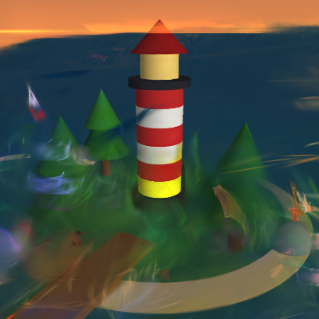

# 3D — Brush lighthouse (Gaussian splatting training on Colab)

One command, one trained splat. This is the repo's first 3D modality:
instead of serving a model or generating a media file, it **trains** a
3D Gaussian splatting scene with [Brush](https://github.com/ArthurBrussee/brush)
(Apache-2.0) on a free Colab T4, from a synthetic multi-view dataset
generated on the VM itself. No photos, no weights to download — the
scene is a lighthouse island at dusk, defined in `build_scene.py`.



## One-kick deploy

```bash
python3 3d/brush-lighthouse/deploy_brush.py [--session brush-lighthouse] [--gpu T4] [--steps 30000] [--out DIR] [--keep]
```

That provisions a T4 session, uploads `setup.py` + `train.py` +
`build_scene.py`, runs setup (Vulkan ICD + Brush 0.3.0), trains,
downloads the result as a base64 tar, decodes it, **verifies the PLY
locally** (header, point count, x/y/z by name, no NaNs), and stops
the session unless `--keep`. Outputs in `--out` (default
`3d/brush-lighthouse/outputs/`):

- `lighthouse_trained.ply` — the trained splat
- `eval/*.png` — Brush's renders of the 8 held-out val views
- `brush_psnr.json` — per-view + mean PSNR, point count, bounds

Prerequisites: `lesterppo/hermes-colab-cli` installed and authenticated
(`python3 colab.py whoami` works); override its path with `COLAB_PY`.
Quota rules are the repo's usual ones: free tier, ~3-8 GPU sessions
per day per account, one GPU session at a time — a 503 / `outcome:2`
on `new` means that account's daily quota is exhausted; switch account
or wait, do not retry-loop.

## Proven result (live, 2026-11-04, free T4)

| | |
|---|---|
| Steps | 30,000 (Brush default; export + eval every 5,000) |
| Wall time | 320.6 s train (setup + dataset gen add ~3 min) |
| Output | 123,025 points, 28 MB, SH degree 3, vertical axis y |
| Val PSNR | **mean 18.59 dB** (per view 17.5–20.5 dB) |
| Looks like | Lighthouse (stripes, lamp room, red roof), trees, pier and island are clearly recognisable; sea/sky edges still have smearing and floater streaks, sailboat faint |

A 4,000-step smoke test (`--steps 4000`, ~44 s train) is recognisable
but smeared (mean PSNR 16.7 dB) — use it only to check the pipeline,
not as the deliverable.

## Wrapper live-test status (read this before re-running)

The 30,000-step numbers above come from the direct 2026-11-04 run.
The repackaged one-kick files were then live-tested the same evening
at 4,000 steps: `setup.py` reached ready in 51 s on a fresh T4,
`train.py` reached ready with mean val PSNR **16.42 dB**, and the
downloaded base64 package decoded to a verified 16,622-point PLY
(compare the direct 4,000-step run: 16,753 points, 16.74 dB — same
pipeline, normal run-to-run variation). That test ran the VM scripts
via colab-rs on cyc236es (isolated registry, global account
untouched) because the colab-py host path failed at session creation
on the then-active account with `gpu-unavailable` (daily quota
exhausted — not a script error, and not retried). So the host
wrapper's `new` / upload / poll / download steps follow
`deploy_media.py`'s proven pattern but were not re-run end-to-end
through colab.py that evening; the VM scripts, the base64 package,
and the host's decode + `verify_ply` were all exercised for real.

## How to view the PLY

Open the Brush web demo in Chrome or Edge and drag
`lighthouse_trained.ply` into it, or load it in any standard
Gaussian splatting viewer that reads PLY properties **by name**:
Brush writes properties alphabetically (x, y, z last); a loader that
assumes x/y/z first will misread it.

For a phone, do NOT use a CDN viewer: the phone-proven presentation
is the standalone builder in `../viewer/` (three.js + Spark embedded,
no CDN — see that README for the four failure modes it fixes).
`viewer.html` in this directory is that offline build for the
lighthouse (libraries embedded, trained PLY loaded from its hosted
URL with the same fallback pattern); regenerate it for a new splat
with `../viewer/build_standalone.py` rather than hand-editing it.

## Files

- `deploy_brush.py` — host orchestrator (this README's one command).
- `setup.py` — VM setup: Vulkan ICD + Brush 0.3.0 binary. Status:
  `/content/brush_setup_status.json`.
- `train.py` — VM training: dataset gen → train → eval → PSNR →
  base64 package. Status: `/content/brush_train_status.json`.
- `build_scene.py` — the scene + dataset generator (48 train + 8 val
  views, 400×400, nerfstudio `transforms.json`, OpenGL camera-to-world
  matrices, `camera_angle_x` 0.8727). Also writes a procedural PLY
  from the same primitives for comparison; the trained PLY is the
  deliverable, not that file.
- `preview.png` — Brush's eval render of val_004 at 30,000 steps.

## Pitfalls, learned live (do not re-learn these)

1. **Small-image "early eof" (Brush 0.3.0 bug).** `scene.rs
   get_image_data` reads the image header with `read_exact` over a
   16,387-byte buffer; tokio's `read_exact` fails with "early eof"
   when the file is smaller than the buffer. Flat-colour renders
   compress to ~14 KB, so compressed PNGs kill the dataset load in
   ~1 s. The fix, baked into `build_scene.py`, is uncompressed PNGs
   (~480 KB each, pixels identical). Do not "optimise" this back.
2. **No Vulkan ICD on a stock Colab VM.** CUDA works, but only the
   Vulkan loader is installed, so Brush's wgpu backend panics with
   "No possible adapter available" before step 0. `setup.py`
   installs `libnvidia-gl-<loaded-driver-series>` + `vulkan-tools`
   (series read from `nvidia-smi`, never guessed) and verifies an
   ICD file + a T4 in `vulkaninfo`. It never touches the kernel driver.
3. **Use the 0.3.0 prebuilt binary's flags.** It takes
   `--total-steps`, not main-branch `--total-train-iters`, and its
   `--export-path` is relative to the working directory. Do not build
   from source on Colab: main-branch deps need rustc ≥ 1.95, rustup
   gives 1.88.
4. **Binary downloads need base64.** Some Colab download paths fail
   on raw binary files, so `train.py` ships the result as
   `brush_result.b64` (base64 tar) and `deploy_brush.py` decodes and
   verifies it locally.
5. **Status polling must not depend on stdout lines.** Brush's
   progress bars emit no newlines for minutes; `train.py` polls the
   brush process and refreshes the status file every 10 s, and the
   host polls the status file every 60 s.

## Deltas vs the 2026-11-04 run (so a reviewer can trust the port)

- Dataset is generated on the VM by `build_scene.py` instead of
  uploaded as a 1.1 MB tarball — same script, same pixels, one less
  host artifact. `build_dataset()` now creates its output dirs
  itself (the original relied on them pre-existing).
- `train.py` polls the process instead of iterating stdout lines
  (see pitfall 5) and takes its step count from
  `/content/brush_config.json` written by the host.
- Everything else — Vulkan series logic, Brush release resolution,
  training flags, export/eval cadence, PSNR computation, base64
  packaging — is the proven run's code, moved, not rewritten.
